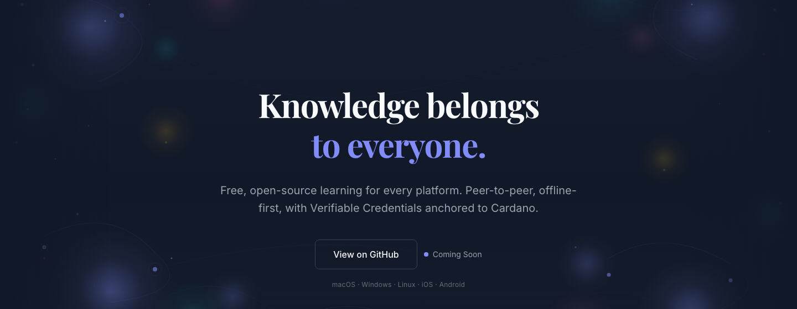

# Alexandria



<p align="center">
  
  
  
</p>

**Free, open-source learning that runs on every device — you own your credentials and your data.**

> **This software is in active development. It is NOT production-ready. Do not use it with real credentials, real funds, or sensitive data.**

## What it is

- **Learn for free, offline.** Courses, tutorials and interactive lessons, plus skill assessments graded on the device. See [skills and reputation](docs/skills-and-reputation.md).
- **Earn portable credentials.** W3C Verifiable Credentials you store, export and verify offline. An issuer can revoke or suspend only the credentials it issued.
- **Keep your data on your device.** No accounts and no data collection: each profile has its own encrypted database and vault.
- **Peer-to-peer.** A libp2p mesh plus iroh for content and live media, with no application server. Relays help peers connect but cannot read traffic. See [architecture](docs/architecture.md).
- **One device, many learners.** Isolated profiles for households, classrooms and shared devices, with guardian links for minors. See [multi-user profiles](docs/multi-user-profiles.md).
- **Assessment integrity on the device.** [Sentinel](docs/sentinel.md) fuses behavioural and environment signals locally; raw signals never leave the device unless the learner releases them to contest a flag.
- **Every platform, nine languages.** macOS, Windows, Linux, iOS and Android, in 9 languages including right-to-left Urdu.

## Quick start (desktop)

You need Rust 1.91+, Node.js 24.22.1 (see [`.nvmrc`](.nvmrc)), the Tauri CLI
(`cargo install tauri-cli`), and the native packages for your OS listed in
[building](docs/building.md#native-packages-for-live-audiovideo-tutoring).

```bash
git clone git@github.com:ifftu-dev/alexandria.git
cd alexandria
npm ci
npm run dev                                   # terminal 1: Vite dev server
cargo tauri dev --features tutoring-video     # terminal 2 (Linux: tutoring-video-static)
```

`cargo tauri dev` does not start Vite for you, so keep `npm run dev` running.
On first launch the app walks you through creating a profile; see the
[user guide](docs/user-guide.md). For iOS and Android, see
[building for mobile](docs/building-mobile.md).

## Status

Everything listed above runs in the alpha today. This is what is missing. No
institution has deployed Alexandria, nobody has been hired on a credential it
issued, and no external user has stress-tested any of it.

| Area | Where it stands |
|---|---|
| **On-chain anchoring** | The anchor queue is wired and submits real transactions, but does nothing unless a Blockfrost project id and a funded wallet are configured. No shipped build anchors by default. Validators are on **preprod testnet only**. |
| **Network** | New peers are found through the relays in the bundled `preprod` [network profile](docs/network-profiles.md); DNS seeds and user-pinned bootstrap lists are post-launch. Existing credentials and content survive relays disappearing; discovering new peers does not. Only DHT provider-record keys use the `/alexandria/preprod` namespace; gossip and request-response protocols keep the unscoped `/alexandria/...` paths until the app, relay and monitoring switch together. |
| **Sentinel** | The false-positive rate is measured against a **synthetic** holdout only; there is no real-world validity study. Android Play Integrity verdicts need the Play Console response keys in the network profile (null in `preprod`), so Android sessions stay `local` ([runbook](docs/sentinel-runbook.md) Procedure 5). Federated learning is design-phase ([sentinel-federation](docs/sentinel-federation.md)). |
| **Plugins** | Practical-trade submissions are reviewed by an instructor on the same node; routing to a remote assessor is a later phase. `music-reviews` has no grader yet, so it cannot produce a score a credential is issued from. |
| **Credential trust policy** | Credentials from any authentic issuer stay visible. Field-opinion posting requires a credential that satisfies the subject qualification policy pinned in the network profile; self-claims never qualify. Instructor endorsement requests and responses are exchanged as JSON by hand. |
| **Push notifications** | In progress, using Firebase Cloud Messaging on iOS and Android. |
| **Independent security audit** | Not commissioned. Internal audits: Pass 1 remediation verified 2026-03-23; Pass 2 completed 2026-08-18 ([report](docs/audits/security-2026.md)). |
| **Organisations and governance** | SSO, ATS delivery, bulk verification, cohort analytics and the employer console are under test in a separate, proprietary repository; none of it is run by anyone outside the project or purchasable, and SIS/SCIM provisioning has not started ([enterprise boundary](docs/enterprise-boundary.md)). Inbound governance changes are rejected until committee outcome certificates exist. The non-profit veto over free learner access in [vision](docs/vision.md) has not been drafted. |

Subsystem docs carry their own scope and status, for example the
[interview assistant](docs/interview-assistant.md#scope-and-status).

## Documentation

The full, annotated list is the [documentation index](docs/README.md).

| For | Start with |
|---|---|
| Using the app | [User guide](docs/user-guide.md) · [Demo setup](docs/demo/setup.md) · [Optional AI checks](docs/jev-integration.md) |
| Building and contributing | [Building](docs/building.md) · [Mobile](docs/building-mobile.md) · [Developer CLI](cli/README.md) · [Contributing](CONTRIBUTING.md) · [Releasing](docs/releasing.md) |
| How it works | [Architecture](docs/architecture.md) · [Protocol specification](docs/protocol-specification.md) · [Skills and reputation](docs/skills-and-reputation.md) · [Sentinel](docs/sentinel.md) · [Plugins](docs/plugins.md) · [Network profiles](docs/network-profiles.md) |
| Reference | [Database schema](docs/database-schema.md) · [Project structure](docs/project-structure.md) · [Settings](docs/settings.md) · [Changelog](CHANGELOG.md) |
| Audits | [Security](docs/audits/security-2026.md) · [Performance](docs/audits/performance-2026.md) |

## Contributing

Contributions are welcome under the DCO sign-off; no contributor agreement is
needed. Read [CONTRIBUTING.md](CONTRIBUTING.md) for licensing, the pre-push
checks (`./scripts/check.sh`), and the commit message format.

## Security

No independent audit has been commissioned yet. The internal audit reports
and their remediation status are in [docs/audits/](docs/audits/security-2026.md).

## License

Alexandria is free software under the [GNU Affero General Public License v3 or later](LICENSE.md). `crates/alexandria-verify` is MIT OR Apache-2.0 so anyone can embed credential verification. Vendored third-party crates keep their own licences (`crates/iroh-moq`, `crates/moq-media` and `crates/live` are Copyright (C) 2025 N0, INC, MIT OR Apache-2.0).
